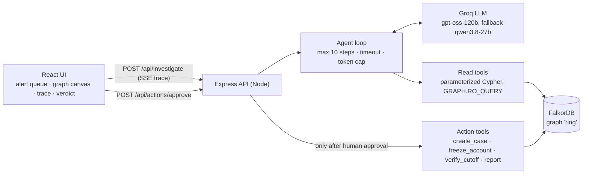

# RingBreaker

**An AI agent that investigates UPI mule rings in a FalkorDB graph, freezes the ring after a human approves, and then proves with a graph query that no money path remains.**

Graph Hacks: Context for AI Agents (FalkorDB), Track 01: Agents That Act on Connected Data.

- **Live demo:** https://ringbreaker-5o88.onrender.com (free tier: the first load after idle takes about a minute)
- **Data:** 100% synthetic. No real people, accounts, phone numbers or UPI IDs.

---

## The problem

Scam money is laundered through chains of ordinary-looking "mule" bank accounts. Each hop looks harmless on its own: a small transfer between two people. The pattern only shows when you follow the connections: money fanning in and straight back out within minutes, new low-KYC accounts, several accounts sharing one phone or device. That is a graph problem.

Most fraud tools stop at "flagged". RingBreaker closes the loop:

1. **Investigate.** An LLM agent walks the graph with multi-hop Cypher tools, starting from an alert.
2. **Decide.** It returns a structured, validated verdict: ring members, their roles, and evidence citing graph facts.
3. **Act, with approval.** A human approves the freeze in the UI. The agent has no tool that can freeze anything.
4. **Verify.** A path query counts the active money routes into the cash-out account before and after the freeze, for example **13 routes, then 0**.

## Architecture



One investigation:

1. The user clicks an alert. `POST /api/investigate` starts the agent and streams every step back as Server-Sent Events.
2. The agent calls read tools. Each call emits a trace event: tool, arguments, the exact Cypher, a one-line summary, and the node and edge IDs it touched. The canvas uses those IDs to light up the subgraph as the agent works.
3. The agent finishes by calling `submit_verdict`. The server validates the verdict and saves it as a `Case` node.
4. The user reviews the evidence, ticks accounts and approves. `POST /api/actions/approve` runs `verify_cutoff`, freezes the approved accounts, then runs `verify_cutoff` again and returns both numbers.

### Graph model

| Nodes | Relationships |
|---|---|
| `Account {id, holder, created_at, kyc_level, status, balance}` | `(Account)-[:SENT {txn_id, amount, ts}]->(Account)`: one edge per transaction |
| `VPA {handle}`, `Device {id, os}`, `Phone {number}` | `HAS_VPA`, `USES_DEVICE {last_seen}`, `LINKED_PHONE` |
| `Alert {id, type, created_at, summary}` | `(Alert)-[:ABOUT]->(Account)` |
| `Case {id, verdict, confidence, ...}` (written by the system) | `(Case)-[:INCLUDES {role}]->(Account)`, `(Case)-[:ACTION {type, ts, approved_by}]->(Account)` for the audit trail |

Transactions are edges rather than nodes, so a 4-hop money trail is a 4-hop path and variable-length queries (`-[:SENT*1..4]->`) stay short and fast.

### Agent tools

| Tool | What it answers |
|---|---|
| `get_alert` | The alert and the account it points at |
| `account_profile` | Account age, KYC level, VPAs, devices, phones, and how many other accounts share each |
| `money_trail` | Follow money forward or backward up to 4 hops since a date |
| `fan_stats` | In and out degree, totals, time spread, pass-through ratio |
| `shared_identity` | Other accounts on the same device or phone |
| `expand_ring` | Grow a candidate ring from seed accounts by money and identity links |
| `run_readonly_cypher` | Guarded free-form fallback (see Safety) |
| `submit_verdict` | The final structured answer, validated server-side |

Action tools (`create_case`, `freeze_account`, `verify_cutoff`, `generate_report`) are **not offered to the model**. They are called only by the API.

### The verify query

```cypher
MATCH p = (src:Account)-[:SENT]->(m:Account)-[:SENT*0..5]->(t:Account)
WHERE m.id IN $ring AND t.id IN $terminals AND NOT src.id IN $ring
  AND none(n IN nodes(p) WHERE n.status = 'frozen')
RETURN count(DISTINCT [n IN nodes(p) | n.id]) AS routes,
       count(DISTINCT src) AS sources
```

It counts distinct routes by which outside money can still reach the ring's terminal (cash-out) accounts without passing through a frozen account. Before the freeze it is greater than 0; after a correct freeze it is 0.

## How RingBreaker uses FalkorDB

FalkorDB is the project's **only datastore**, and the agent's whole investigation runs inside it. Every step the agent takes is a Cypher query. The verdict, the approved freezes and the audit trail are written back into the same graph. The proof of the cut-off is one more graph query. There is no SQL database, cache or side store.

### What lives in the graph

One graph named `ring`: 7,847 nodes and 25,962 edges.

| | Count | Notes |
|---|---|---|
| `Account` | 1,911 | ~1,900 ordinary customers + planted rings A/B/C, a merchant and a family |
| `VPA` / `Device` / `Phone` | 1,911 / 2,115 / 1,903 | Identity nodes: two accounts on one `Device` is a 2-hop pattern |
| `SENT` edges | 20,007 | **One edge per transaction**, carrying `amount` and `ts` |
| `USES_DEVICE`, `LINKED_PHONE`, `HAS_VPA` | 2,126 / 1,911 / 1,911 | |
| `Alert` + `ABOUT` | 7 | The investigation entry points |
| `Case`, `INCLUDES`, `ACTION` | written at run time | Verdicts, ring roles, and freeze audit edges |

Transactions are modelled as edges, not nodes, on purpose: a money trail of N transfers is then an N-hop path, so FalkorDB's variable-length traversal (`-[:SENT*1..4]->`) answers "where did the money go?" in one query.

### Two ways in: `GRAPH.QUERY` and `GRAPH.RO_QUERY`

All access goes through `server/src/db.js`, which uses the official `falkordb` Node client and exposes exactly two helpers:

```js
readQuery(cypher, params)   // graph.roQuery(...) -> GRAPH.RO_QUERY, TIMEOUT 5s
writeQuery(cypher, params)  // graph.query(...)   -> GRAPH.QUERY,    TIMEOUT 30s
```

- Every agent tool, including the LLM-written free-form Cypher, uses `readQuery`. `GRAPH.RO_QUERY` makes **FalkorDB itself** refuse any query that would write, so the agent's read path cannot mutate the graph even if our keyword guard were bypassed. A test bypasses the guard and confirms FalkorDB still blocks the write.
- Only the seed script and the approval-gated action tools call `writeQuery`.
- Both pass FalkorDB's server-side `TIMEOUT`, so a runaway traversal is killed inside the database, not just abandoned by the client.
- Both always take a params object. Values reach FalkorDB as `$parameters`, never spliced into query text.

### Indexes

At startup (`server/src/schema.js`) we create a range index on each lookup key, `CREATE INDEX FOR (n:Account) ON (n.id)`, and likewise for `Device.id`, `Phone.number`, `VPA.handle`, `Alert.id` and `Case.id`. Every tool starts from an indexed lookup such as `(:Account {id: $account_id})` and traverses outward from there, so a query touches only the neighbourhood it explores, not the whole label.

### Loading the data

`scripts/seed.js` wipes and reloads the graph in batches of 1,000 rows. Each batch is sent as **one parameter** and expanded inside FalkorDB with `UNWIND`:

```cypher
UNWIND $rows AS r
MATCH (a:Account {id: r.from}), (d:Device {id: r.to})
CREATE (a)-[:USES_DEVICE {last_seen: r.last_seen}]->(d)
```

The full load takes about 0.3 s against local Docker and 3.4 s against FalkorDB Cloud, and the script checks the final counts against the source file.

### The Cypher behind each agent tool

| Tool | Graph pattern | Why it needs a graph |
|---|---|---|
| `money_trail` | `(a {id:$id})-[:SENT*1..N]->(x)` with `all(r IN relationships(p) WHERE r.ts >= $since)` | Multi-hop money flow, filtered on **every** edge of the path, in one query |
| `shared_identity` | `(a)-[:USES_DEVICE\|LINKED_PHONE]->(x)<-[:USES_DEVICE\|LINKED_PHONE]-(b)` | Two accounts linked through a shared device **or** phone: one pattern with a multi-type relationship |
| `expand_ring` | `UNION ALL` of a money hop and an identity hop from a set `$ids`, ranked by weight | Grows a ring along both kinds of link at once |
| `fan_stats` | Inbound aggregation, `WITH`, then outbound aggregation | Degree and pass-through ratio without row multiplication |
| `account_profile` | Chained `OPTIONAL MATCH` + `collect(DISTINCT ...)`, counting how many accounts share each device or phone | Shows in one call whether an identity is shared |
| `verify_cutoff` | Path query with `none(n IN nodes(p) WHERE n.status = 'frozen')` | Can money still get through? A question about paths, not rows |

For example, `money_trail` returns the distinct transactions on every qualifying path rather than hundreds of near-duplicate paths:

```cypher
MATCH p = (a:Account {id: $account_id})-[:SENT*1..4]->(x:Account)
WHERE all(r IN relationships(p) WHERE r.ts >= $since)
WITH p LIMIT 500
WITH collect(p) AS paths, count(p) AS path_count
UNWIND paths AS p
UNWIND relationships(p) AS r
WITH DISTINCT path_count, r
RETURN path_count, startNode(r).id AS from, endNode(r).id AS to, r.txn_id, r.amount, r.ts
ORDER BY r.ts
```

From Ring A's victim this returns the complete laundering chain (6 accounts, 20 transactions) out of 232 matching paths.

### Writes, audit and verification inside the graph

- **The approval gate is a single query.** `freeze_account` freezes only if the account is in the case's `proposed_freezes` and still active, and writes the audit edge in the same statement:
  ```cypher
  MATCH (c:Case {id: $case_id}), (a:Account {id: $account_id})
  WHERE $account_id IN c.proposed_freezes AND a.status = 'active'
  SET a.status = 'frozen'
  CREATE (c)-[:ACTION {type: 'freeze', ts: $now, approved_by: $approved_by, reason: $reason}]->(a)
  ```
- **The audit trail is graph data.** `(Case)-[:INCLUDES {role}]->(Account)` and `(Case)-[:ACTION]->(Account)` sit next to the transactions they explain, so the report and the canvas read them with ordinary traversals.
- **Verification is a path query** (shown above). It counts **distinct routes**, meaning sequences of account IDs, rather than raw paths. Because every transaction is its own edge, split payments multiply paths: Ring A has 1,488 raw paths but only 13 distinct routes into its cash-out. After the freeze, FalkorDB returns 0.
- **The canvas reads the graph directly.** `/api/graph/subgraph` fetches exactly the node IDs named in the agent's trace with one indexed `UNION ALL` lookup per label, plus every edge between them, using `startNode()`/`endNode()` to keep direction and `coalesce(b.id, b.number, b.handle)` because each label has its own key.

### FalkorDB specifics we worked with

- **Edge direction and variable-length bounds can't be parameters** in Cypher. `money_trail` therefore pre-builds one query text per (direction, hops) pair from constants at load time, and the caller only picks a key. User input never becomes query text.
- **Labels can't be parameters either**, so `CREATE INDEX` is built from a fixed constant list. It's the only place query text is assembled. Re-running it is safe: we treat FalkorDB's "already indexed" error as success.
- **Path predicates** (`all()`, `none()` over `relationships(p)` / `nodes(p)`), multi-type relationships (`A|B`), `UNION ALL`, `startNode()`/`endNode()` and list comprehensions over `nodes(p)` all worked as expected. Each query was tried in the FalkorDB Browser (`localhost:3000`) before being wired into a tool.
- **Times are epoch-millisecond numbers.** Comparing them to a date string matches nothing. When the agent did that in free-form Cypher it got empty results, so the tool description now states the type explicitly.
- **FalkorDB Cloud** hosts the production graph. It's the same client and code path as local Docker, configured only by `FALKORDB_HOST/PORT/USERNAME/PASSWORD`. The deployed container can rebuild the demo graph on demand (`POST /api/admin/reseed`).

### Performance

Measured on today's runs, a typical tool query takes **5–30 ms** against local FalkorDB and **230–470 ms** from the Render container to FalkorDB Cloud, mostly network round-trip. Either way, the database is a rounding error next to the LLM: a full investigation takes 1–5 minutes, almost all of it spent waiting on free-tier rate limits.

## Safety model

The agent reads untrusted data and writes Cypher, so safety lives in code, not in the prompt.

- **Read tools cannot write.** Every read runs through `GRAPH.RO_QUERY`, which FalkorDB itself refuses to execute if the query would write. A test bypasses our own guard and confirms FalkorDB still blocks the write.
- **Free-form Cypher is guarded** (`server/src/guard.js`). It rejects `CREATE`, `MERGE`, `DELETE`, `SET`, `REMOVE`, `DROP`, `CALL`, `LOAD`, `FOREACH` and multi-statement input, enforces a `LIMIT`, and runs with a server-side timeout.
- **Everything is parameterized.** No Cypher is ever built by string concatenation, including the seed script, which sends rows as one `$rows` parameter.
- **The model cannot freeze.** It can only recommend. Freezing happens in `POST /api/actions/approve`, which needs a named approver and refuses any account the case did not propose. Every freeze writes an audit edge saying who approved it and when.
- **Verdicts are grounded.** `validateVerdict` rejects ring members the tools never returned, freeze recommendations for victims or non-members, and freezes on anything weaker than `ring_confirmed`.
- **Graph text is data, not instructions.** Holder names, handles and alert text are treated as untrusted in the system prompt, and none of it can trigger an action, because the model has no action tools.
- **Hard limits per run:** 10 model steps (the last one may only submit a verdict), a 10-minute timeout, a 120K-token cap, and one investigation at a time.
- **Public demo:** investigations and approvals need a demo passcode (`DEMO_PASSCODE`), and resetting the graph needs an admin secret. Both are compared in constant time.

## Running on the Groq free tier

The free tier allows about 8K tokens per minute and 200K tokens per day **per model**, and some models have smaller per-request caps. The loop is built around that:

- Older tool results are replaced by their one-line summaries once the prompt passes about 5.5K tokens, and tool results are compacted.
- **Model fallback:** if `MODEL` runs out of daily quota mid-run, the loop switches to `FALLBACK_MODEL` and continues from the same step with the same conversation. The trace shows a `model_switch` event.
- If a model rejects a request as too large for its per-minute input or output cap (Qwen: 7K input, 1K output), the loop shrinks the context or the output cap and redoes the step.

## Evaluation

`npm run eval` runs the agent on every alert and scores it against `data/ground_truth.json`.

Planted scenarios: **Ring A**, a layering chain (victims → layer mules → collector → cash-out). **Ring B**, a device farm (6 accounts, 2 devices, 1 phone, fan-in). **Ring C**, a decoy with a shared device but no money flow, which should come back "monitor", not "freeze". Plus benign look-alikes: a high-fan-in merchant and a family sharing one device.

Results on Oct 16, 2026 (most steps ran on the fallback model because the primary ran out of daily quota; ALT003 was re-run after its first attempt hit a Qwen input limit, since fixed):

| Alert | Scenario | Expected | Got | Freeze precision / recall |
|---|---|---|---|---|
| ALT001 | Ring A complaint | ring_confirmed | ✅ ring_confirmed | 1.00 / 0.71 |
| ALT002 | Ring B complaint | ring_confirmed | ✅ ring_confirmed | 1.00 / 1.00 |
| ALT003 | Ring B fan-in | ring_confirmed | ✅ ring_confirmed | 1.00 / 1.00 |
| ALT004 | Ring C decoy | suspicious | ✅ suspicious, no freeze | |
| ALT005 | Merchant | benign | ✅ benign | |
| ALT006 | Family | benign | ✅ benign | |
| ALT007 | Noise | benign | ✅ benign | |

**7 of 7 verdicts correct, 0 unsafe freezes.** No victim or benign account was ever recommended for freezing.

## Run it locally

Requirements: Node.js 22.9+ (uses `--env-file-if-exists`; developed on 24), Docker, and a free Groq API key (https://console.groq.com/keys).

```bash
git clone https://github.com/Jeevesh2605/ringbreaker && cd ringbreaker
cp .env.example .env               # add GROQ_API_KEY
docker compose up -d               # FalkorDB on :6379, FalkorDB Browser on http://localhost:3000
(cd server && npm install) && (cd web && npm install)
npm run generate && npm run seed   # synthetic graph (seeded, reproducible) into FalkorDB

(cd server && npm start)           # API on http://localhost:8080
(cd web && npm run dev)            # UI on http://localhost:5173
```

Or the whole app in containers, the same image as production:

```bash
docker compose --profile app up -d --build
curl -X POST localhost:8080/api/admin/reseed -H "x-admin-secret: <ADMIN_SECRET from .env>"
# open http://localhost:8080
```

Useful commands:

```bash
npm run tool -- money_trail '{"account_id":"ACC0438","direction":"forward","max_hops":4,"since":"2026-10-12"}'   # one tool, no LLM
npm run eval -- ALT001 --trace                                                              # agent on one alert
(cd server && npm test)                                                                     # 48 tests: guard, verdict rules, actions, fallback, passcode
```

## Deployment

One Docker image (`Dockerfile`) runs on Render's free tier, defined by the `render.yaml` Blueprint. Express serves the API and the built React UI on the same origin, so there is no CORS. The graph lives on FalkorDB Cloud.

The image generates the seeded graph file at build time, so `POST /api/admin/reseed` restores the demo state from inside the container. Secrets (`GROQ_API_KEY`, the FalkorDB credentials, `DEMO_PASSCODE`) are set in the Render dashboard; `ADMIN_SECRET` is generated by Render. None of them are in the repo.

## API

| Method | Route | Purpose |
|---|---|---|
| GET | `/api/alerts` | Alert queue |
| POST | `/api/investigate` `{alertId}` | Run the agent; SSE stream of trace events ending with the verdict and case ID (passcode) |
| POST | `/api/actions/approve` `{caseId, actions[], approvedBy}` | Freeze the approved accounts and return verify before/after (passcode) |
| GET | `/api/graph/subgraph?nodeIds=` | Nodes and edges for the canvas |
| GET | `/api/case/:id/report` | Markdown investigation report, built only from stored graph values |
| POST | `/api/admin/reseed` | Reset the demo graph (header `x-admin-secret`) |

## Project layout

```
data/generate.js       seeded synthetic data: rings A/B/C, merchant, family, noise
scripts/               seed.js, run-tool.js, eval.js
server/src/db.js       all FalkorDB access (readQuery = RO_QUERY, writeQuery)
server/src/guard.js    free-form Cypher guard
server/src/tools/      one file per tool, each with its Cypher explained in comments
server/src/agent/      loop.js (limits, trimming, fallback), prompt.js, verdict.js (validation)
server/src/routes/     alerts, investigate (SSE), actions (approval gate), graph, admin
web/src/               App + AlertQueue, GraphCanvas, TracePanel, VerdictCard, VerifyBadge
```

## Disclosures

- **Synthetic data.** Every account, name, phone number, VPA, device and transaction is generated by `data/generate.js` with a fixed seed. Any resemblance to real people is coincidental.
- **AI assistance.** Built with Claude Code as a coding assistant during the hackathon window. I reviewed the code and can explain the architecture and the security choices above; the Cypher in every tool is commented for that reason.
- **Known limits.** Detection is graph rules plus LLM reasoning, not a trained model. Free-tier rate limits make a live run take 1 to 5 minutes. Ring A recall is 0.71: the agent found 5 of its 7 mule accounts. ALT003 needs all 10 steps, so it has no slack.
